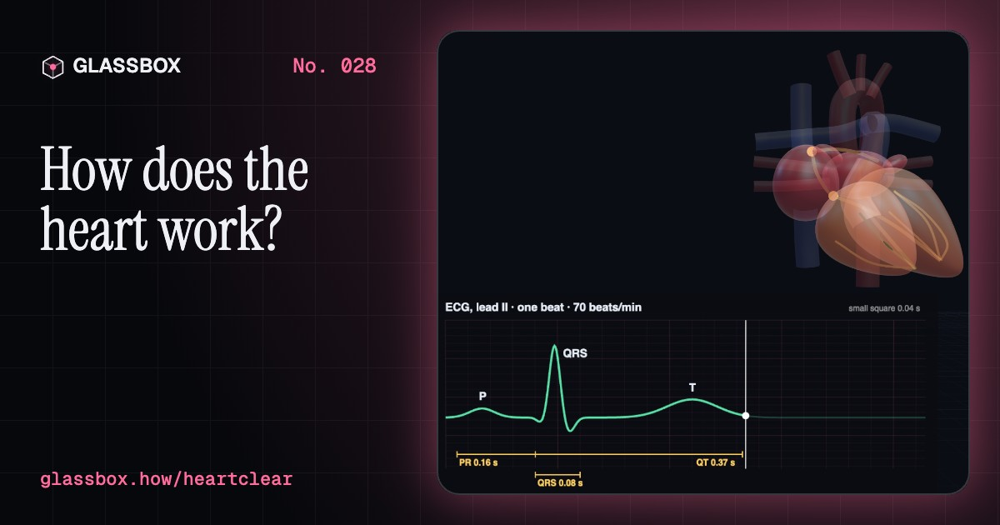
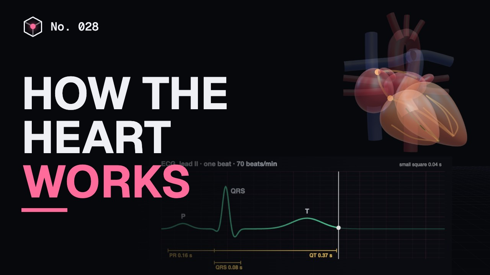
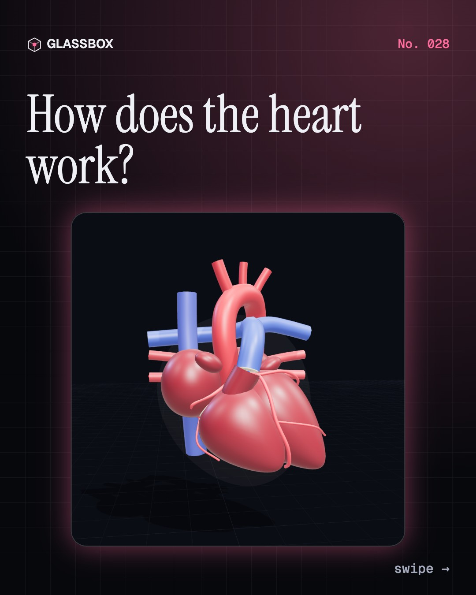
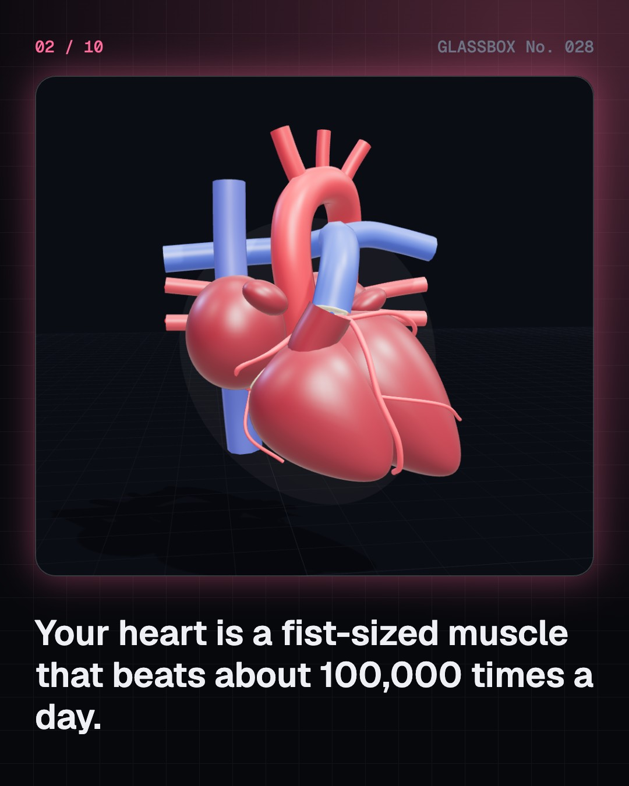
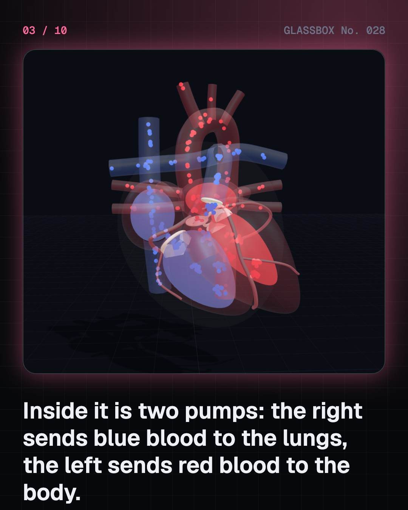
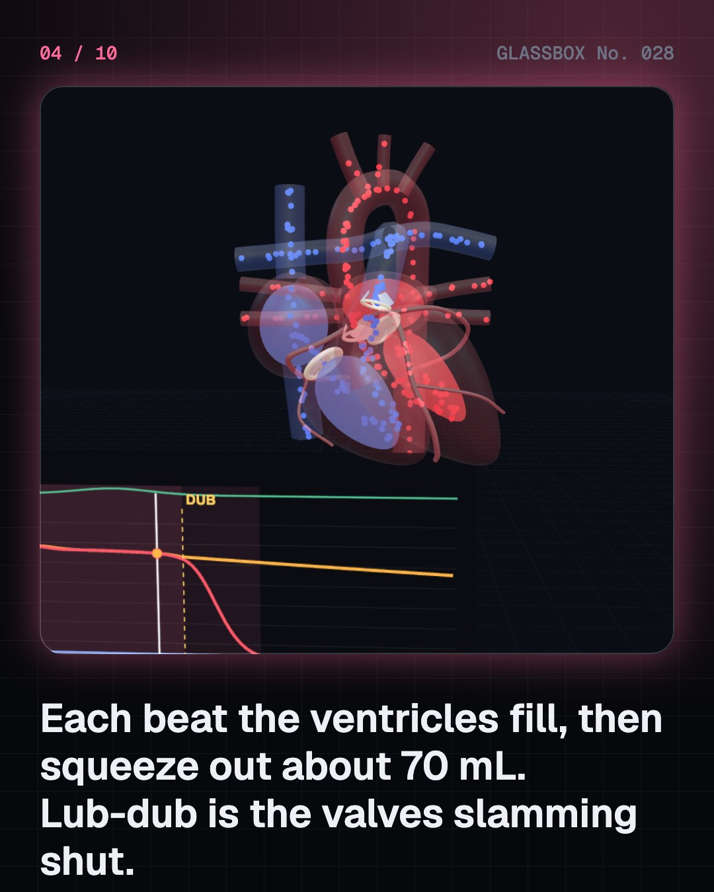

<!-- glassbox:start -->
<!-- Generated from glassbox.json by the Glassbox hub (npm run readme -- heartclear). Edit glassbox.json, not this block. -->
<p align="center"><a href="https://glassbox-production-fd52.up.railway.app/e/heartclear/"></a></p>

<h1 align="center">HeartClear</h1>

<p align="center"><b>How does the heart work?</b><br>Your heart is two pumps in one, beating about 100,000 times a day without a single instruction from you. Take a 3D heart apart, watch its valves slam shut on every lub-dub, and follow the spark that starts each beat.</p>

<p align="center"><a href="https://glassbox-production-fd52.up.railway.app/heartclear/"><b>▶ Play with it</b></a> &nbsp;·&nbsp; <a href="https://glassbox-production-fd52.up.railway.app/e/heartclear/">Read the 60-second explainer</a> &nbsp;·&nbsp; <a href="https://glassbox-production-fd52.up.railway.app/heartclear/glassbox/reel.mp4">Watch the 40-second video</a></p>

<p align="center">
  <a href="https://glassbox-production-fd52.up.railway.app/e/heartclear/"></a>
  <a href="https://glassbox-production-fd52.up.railway.app/e/heartclear/"></a>
  <a href="LICENSE"></a>
  <a href="LICENSE-CONTENT.md"></a>
  <a href="#privacy"></a>
</p>

## In 60 seconds

1. **Two pumps in one.** The heart has four chambers. The right atrium and ventricle send oxygen-poor blood to the lungs; the left atrium and ventricle send oxygen-rich blood to the whole body. Four one-way valves keep it moving in the right direction, and the left ventricle's wall is about three times thicker because it pumps at higher pressure.
2. **Fill, squeeze, lub-dub.** In diastole the ventricles relax and fill; in systole they squeeze out about 70 mL each beat. The 'lub' is the inlet valves slamming shut as the squeeze starts, the 'dub' the outlet valves shutting as it ends. At 70 beats a minute that makes about 5 litres a minute.
3. **A built-in spark.** Each beat starts in the SA node, the heart's natural pacemaker in the right atrium. The signal sweeps over the atria, waits about a tenth of a second in the AV node, then races through the bundle of His and Purkinje fibres so the ventricles squeeze from the bottom up. An ECG records this wave as P, QRS and T.
4. **Two circuits, one minute.** Blood goes from the right heart through the lungs, where it fills with oxygen to about 98%, back to the left heart and out to the body, returning about 75% full at rest. An adult has about 5 litres of blood, so one lap takes about a minute.
5. **120 over 80.** Blood pressure is the peak of each beat (systolic) over the low point between beats (diastolic). A cuff finds them by listening for the tapping of blood forced past a squeezed artery. Stretchy arteries smooth each surge; by the capillaries the pressure is about 35 mmHg and barely pulses.
6. **When things go wrong.** Plaque can narrow a coronary artery, and flow through a tube falls with the fourth power of its radius. A clot on a plaque causes a heart attack, an emergency. CPR at 100 to 120 pushes a minute, 5 to 6 cm deep, keeps some blood moving until help arrives. For your own heart, talk to a doctor.

## Words worth knowing

| Term | Meaning |
|---|---|
| **Atrium and ventricle** | The heart's upper collecting chambers (atria) and lower pumping chambers (ventricles). |
| **Heart valve** | A flap of tissue that lets blood flow only one way. The heart has four: tricuspid, pulmonary, mitral and aortic. |
| **Cardiac cycle** | One heartbeat: diastole, when the ventricles relax and fill, then systole, when they contract and eject blood. |
| **Stroke volume** | The blood one ventricle pumps per beat, about 70 mL at rest. |
| **Cardiac output** | Heart rate times stroke volume: about 5 litres a minute at rest, 15 to 20 in hard exercise. |
| **Ejection fraction** | The share of the blood in a full ventricle that one beat pumps out, normally about 55 to 70%. |
| **SA node** | The heart's natural pacemaker, which fires each beat 60 to 100 times a minute at rest. |
| **ECG** | Electrocardiogram: a recording of the heart's electrical waves, labelled P, QRS and T. |
| **Blood pressure** | The push of blood on artery walls, given as systolic over diastolic in mmHg, around 120/80 in a healthy adult. |

## A short history

**3,500 years from Egyptian scrolls about the heart's vessels to pacemakers, new valves slid in through an artery, and a pig's heart beating in a human chest.**

- **1242** · Blood goes through the lungs (Ibn al-Nafis, Cairo, Egypt)
- **1628** · Blood goes round and round (William Harvey, London, England (printed in Frankfurt, Germany))
- **1816** · The stethoscope (René Laennec, Necker Hospital, Paris, France)
- **1903** · The ECG is born (Willem Einthoven, Leiden, the Netherlands)
- **1944** · Saving the blue babies (Helen Taussig, Alfred Blalock and Vivien Thomas, Johns Hopkins Hospital, Baltimore, USA)
- **1953** · A machine takes over the heart and lungs (John Gibbon, Jefferson Medical College Hospital, Philadelphia, USA)
- **1958** · The first implanted pacemaker (Rune Elmqvist and Åke Senning, Karolinska Hospital, Stockholm, Sweden)
- **1967** · The first human heart transplant (Christiaan Barnard, Groote Schuur Hospital, Cape Town, South Africa)

The full story, with 30 moments, charts, people and 55 sources: [glassbox.how/e/heartclear/history](https://glassbox-production-fd52.up.railway.app/e/heartclear/history/). The data lives in [`history.json`](history.json).

## Video and slides

Made with the Glassbox studio from this box's storyboard (`window.glassbox.director`). Free to reuse under CC BY 4.0.

<a href="https://glassbox-production-fd52.up.railway.app/heartclear/glassbox/video.mp4"></a>

<p><a href="glassbox/slide-1.jpg"></a> <a href="glassbox/slide-2.jpg"></a> <a href="glassbox/slide-3.jpg"></a> <a href="glassbox/slide-4.jpg"></a></p>

| File | What | Size |
|---|---|---|
| [`glassbox/reel.mp4`](https://glassbox-production-fd52.up.railway.app/heartclear/glassbox/reel.mp4) | Reel / Short, with captions and soundtrack | 1080×1920 |
| [`glassbox/video.mp4`](https://glassbox-production-fd52.up.railway.app/heartclear/glassbox/video.mp4) | YouTube video, with captions and soundtrack | 1920×1080 |
| `glassbox/slide-1…10.jpg` | Instagram carousel | 1080×1350 |
| `glassbox/thumb.jpg` | YouTube thumbnail | 1280×720 |
| `glassbox/cover.jpg` | Share card and repo social preview | 1200×630 |
| [`glassbox/history-reel.mp4`](https://glassbox-production-fd52.up.railway.app/heartclear/glassbox/history-reel.mp4) | “History in 10 moments” Reel / Short | 1080×1920 |
| `glassbox/history-slide-*.jpg` | History carousel | 1080×1350 |
| `glassbox/post.json` | Post copy and schedule used by the publish kit | |

## Privacy

This box has no accounts and no ads, and it ships its own fonts and libraries. When you run it yourself it sends nothing anywhere. On glassbox.how, the site's `/bar.js` also loads Glassbox's analytics: **Google Analytics** to count visits (it asks first in the EU, UK and Switzerland, and stays off when your browser sends Global Privacy Control or Do Not Track) and **ClickTrust** to detect bots.

It remembers a few things **in your own browser only**, and never sends them anywhere:

| Browser storage key | What it holds |
|---|---|
| `heartclear.v1` | Which chapters you have opened, your best quiz scores, and sound on or off. |

Exactly what each one sees is at [glassbox.how/privacy](https://glassbox-production-fd52.up.railway.app/privacy/).

## Licences

- **Code:** [MIT](LICENSE). Use it, change it, ship it.
- **Explanations, text, images and videos** (`glassbox.json`, `glassbox/`): [CC BY 4.0](LICENSE-CONTENT.md). Credit “Glassbox, glassbox.how/e/heartclear”.
- **Third-party parts** keep their own licences: [three.js](https://threejs.org) (MIT), [Geist, Instrument Serif](https://openfontlicense.org) (SIL OFL 1.1).
- The Glassbox name and logo aren't covered by either licence. See the [terms](https://glassbox-production-fd52.up.railway.app/terms/).

Found a mistake? [Open an issue](https://github.com/bdeeps/heartclear/issues). Corrections happen in public.
<!-- glassbox:end -->

## Run it

It's plain HTML, CSS and JavaScript. No build step and no dependencies. Run locally, it contacts no other website.

```bash
python3 -m http.server 8000
```

Three.js and the fonts ship in `vendor/` and `fonts/`, so it also works offline.

Then open http://localhost:8000.

## How it's built

| File | What |
|---|---|
| `index.html`, `css/app.css` | The page and its styles |
| `js/app.js`, `js/stage.js`, `js/ui.js`, `js/kit.js` | The shared Glassbox 3D engine: chapters, 3D stage, controls, quiz, video director |
| `js/chapters/*.js` | One file per chapter: the 3D model, controls, text, key terms, quiz and video scenes |
| `js/heart.js` | The 3D heart shared by the chapters: chambers, valves, great vessels, coronary arteries, pericardium, and blood that flows through it in step with the pump model |
| `js/physio.js` | The physiology: a time-varying-elastance left heart with a windkessel artery model (pressures, volumes, valve timing), the ECG waves, and textbook reference numbers with their sources |
| `glassbox.json` | Title, question, explainer beats, key terms, browser storage and credits shown on glassbox.how |
| `reel` in each chapter | The storyboard the Glassbox studio records into short videos |
| `glassbox/` | The published video, slides, thumbnail and post copy |
| `fonts/`, `vendor/three/` | Self-hosted Geist and Instrument Serif (SIL OFL 1.1) and three.js (MIT) |
